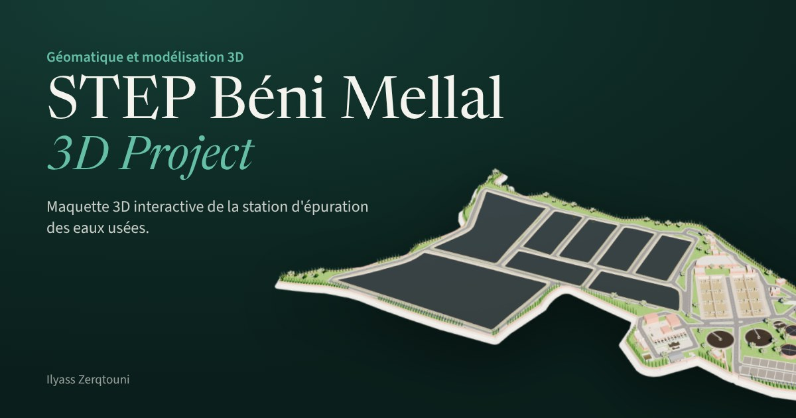
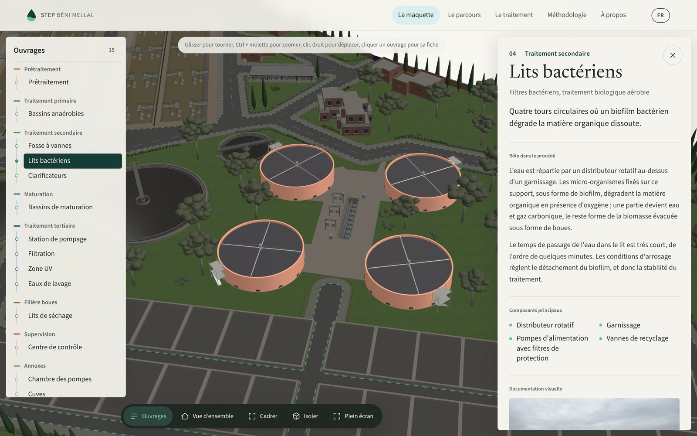
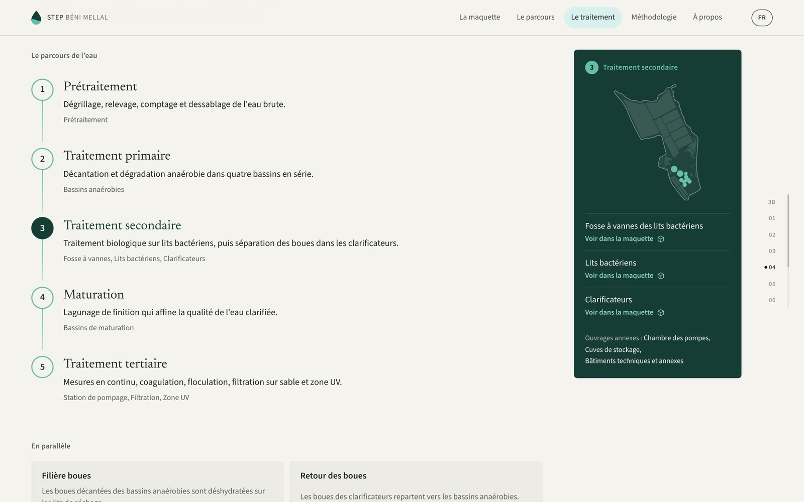
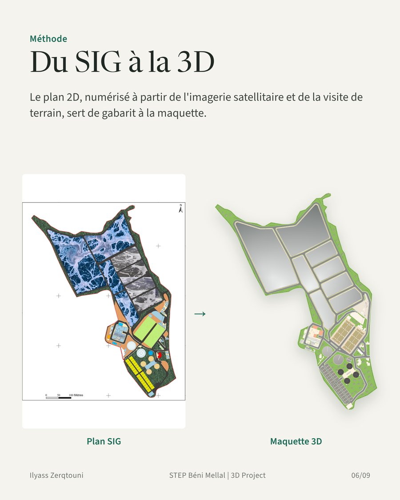
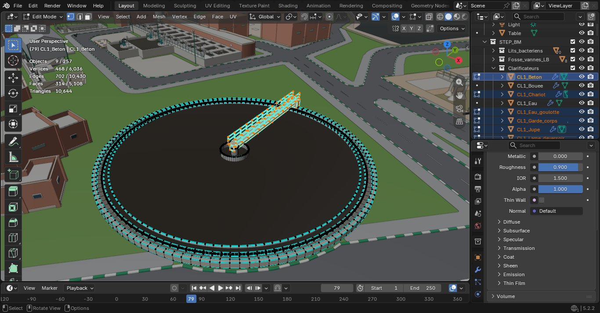

<p align="center">
  
</p>

<h1 align="center">STEP Béni Mellal 3D</h1>

<p align="center">
  Maquette 3D interactive de la station d'épuration des eaux usées de Béni Mellal (Maroc)<br>
  <em>Interactive 3D model of the Béni Mellal wastewater treatment plant</em>
</p>

<p align="center">
  <a href="https://ilyass2004d.github.io/STEP_Beni_Mellal/"><strong>Voir le site</strong></a>
  &nbsp;|&nbsp;
  <a href="#english">English</a>
</p>

---

## Le projet

Ce projet présente la station d'épuration (STEP) de Béni Mellal à travers une maquette 3D que l'on explore directement dans le navigateur. Il part d'une visite pédagogique de la station et d'un travail SIG, puis passe par la modélisation sous Blender, jusqu'à un site web interactif en français et en anglais.

Le site sert à lire la station : où se trouve chaque ouvrage, à quoi il sert et comment l'eau passe d'une étape à l'autre.

<p align="center">
  
</p>

## Ce que l'on peut faire sur le site

- **Arriver depuis l'imagerie satellitaire** jusqu'à la maquette, posée exactement sur l'emprise réelle de la station.
- **Explorer la maquette 3D** : rotation, zoom, plein écran, vue d'ensemble.
- **Choisir un ouvrage** dans la maquette ou dans la légende : le reste du site s'assombrit, l'ouvrage garde ses couleurs et sa fiche s'ouvre (rôle dans le procédé, composants, photos, position sur le plan).
- **Suivre la chaîne de traitement** étape par étape, du prétraitement au traitement tertiaire, avec les flux parallèles (boues, retours, supervision).
- **Découvrir la méthode**, du terrain au rendu 3D.
- **Changer de langue** (FR / EN) à tout moment.

<p align="center">
  
</p>

## Méthode

| Étape | Travail |
|---|---|
| 1. Terrain | Visite pédagogique de la station et photographies des ouvrages |
| 2. Imagerie | Lecture de l'organisation du site sur l'imagerie satellitaire (Esri World Imagery) |
| 3. SIG | Système de coordonnées Merchich / Nord Maroc (EPSG:26191), limite de la station (17,92 ha) |
| 4. Cartographie 2D | Numérisation des ouvrages, de la voirie et des espaces verts |
| 5. Modélisation 3D | Construction des ouvrages sous Blender, à l'échelle (1 unité = 1 mètre) |
| 6. Web | Export optimisé de la maquette et site interactif |

<table>
  <tr>
    <td width="40%"></td>
    <td></td>
  </tr>
</table>

## La maquette en chiffres

| | |
|---|---|
| Emprise modélisée | 579 × 771 m, identique à l'emprise du plan SIG (17,92 ha à l'intérieur de la limite) |
| Échelle | système métrique, 1 unité Blender = 1 mètre |
| Objets | 254 objets maillés, rangés en 20 collections, une par ouvrage ou groupe d'ouvrages |
| Géométrie | environ 645 000 sommets et 950 000 triangles |
| Matériaux | 114 matériaux procéduraux |
| Finition | biseaux et normales pondérées sur 195 objets pour des arêtes propres |
| Végétation | cyprès, eucalyptus, rosiers, romarin et gazania répartis par Geometry Nodes |
| Web | la maquette est découpée en pièces glTF compressées (Draco) et chargée progressivement |

## Technologies

- **SIG** : ArcGIS, reprojection en WGS84 avec Python (pyproj, geopandas)
- **3D** : Blender, export glTF compressé (Draco)
- **Web** : React, TypeScript, Vite, Three.js, MapLibre GL
- **Hébergement** : GitHub Pages, publié automatiquement par GitHub Actions

## Lancer le projet en local

Prérequis : Node.js 18 ou plus récent.

```bash
npm install
npm run dev       # serveur de développement, http://localhost:5173
npm run build     # vérification TypeScript et version de production dans dist/
npm run preview   # aperçu de la version de production
```

## Organisation du code

```
src/
  components/      sections de la page, maquette, carte, fiches
  three/           moteur de la maquette 3D (Three.js)
  content/         textes et fiches des ouvrages (FR et EN)
  data/            chaîne de traitement, méthode, auteur, géométrie SIG
  i18n/            textes de l'interface
public/
  models/          maquette 3D optimisée pour le web
  media/           rendus, photos et vidéos
tools/             scripts de préparation des données (géométrie, vue de dessus)
docs/              version publiée du site (générée par npm run build:pages)
readme/            images de ce README
```

Les textes se modifient dans `src/content/content.fr.json` et `content.en.json` (mêmes identifiants dans les deux fichiers).

## Mise en ligne

La version publiée du site se trouve dans le dossier `docs/`, servi par GitHub Pages :

1. Dans le dépôt, ouvrir **Settings > Pages**.
2. **Source : Deploy from a branch**, branche **main**, dossier **/docs**, puis **Save**.
3. Après une ou deux minutes, le site est en ligne à l'adresse https://ilyass2004d.github.io/STEP_Beni_Mellal/

Après une modification du code ou des textes, regénérer `docs/` puis envoyer les changements :

```bash
npm run build:pages
```

## Sources et précautions

- Rapport de visite de la station d'épuration des eaux usées de Béni Mellal, F. Jedouane et I. Zerqtouni, sous la direction du Pr A. Arioua, FST Béni Mellal, Université Sultan Moulay Slimane, 2025-2026.
- Photographies de la visite pédagogique du 10/12/2025.
- Plan SIG de la station, réalisé à partir de l'imagerie satellitaire et de la visite de terrain.
- Imagerie : Esri World Imagery (attribution affichée sur la carte).

Ce site est une présentation pédagogique et visuelle. Il ne remplace pas la documentation officielle de la station, qui reste un ouvrage public géré par ses exploitants.

## Auteur

**Ilyass Zerqtouni**
Doctorant, Université Cadi Ayyad, Faculté des Sciences et Techniques de Marrakech
Géomatique, modélisation 3D, SIG et télédétection

[LinkedIn](https://www.linkedin.com/in/zerqtouni) · [GitHub](https://github.com/ilyass2004d) · ilyasszerqtouni5@gmail.com

© 2026 Ilyass Zerqtouni. Tous droits réservés : la maquette 3D, les rendus, les photographies et les textes ne peuvent pas être réutilisés sans autorisation.

---

<a id="english"></a>

## English

**STEP Béni Mellal 3D** is an interactive 3D model of the Béni Mellal wastewater treatment plant (Morocco), explored directly in the browser.

The project starts from a field visit and GIS work, goes through 3D modeling in Blender, and ends in a bilingual (French / English) website. Visitors can fly in from satellite imagery, rotate and zoom the model, select any treatment unit to read its fact sheet, and follow the treatment line step by step.

**Live site:** [ilyass2004d.github.io/STEP_Beni_Mellal](https://ilyass2004d.github.io/STEP_Beni_Mellal/)

**Stack:** ArcGIS and Python for GIS, Blender for 3D, React, TypeScript, Vite, Three.js and MapLibre GL for the web.

This is an educational and visual presentation, not the official documentation of the plant.

© 2026 Ilyass Zerqtouni. All rights reserved.
